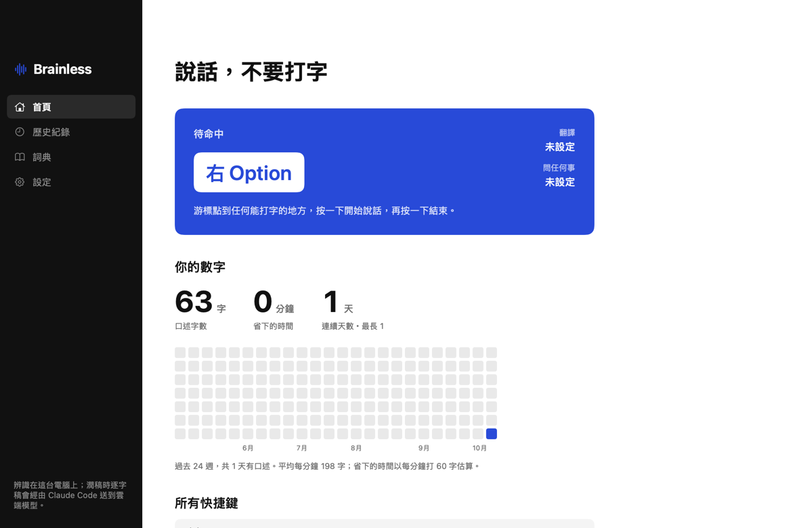

# Brainless

**說話，不要打字。** macOS 語音聽寫 App：按一下快捷鍵說話，再按一下，整理好的文字就出現在游標那裡。

語音辨識用 Whisper large-v3（whisper.cpp，Metal），預設在本機跑；想要更快，也可以改用遠端的 OpenAI 相容端點（Groq、OpenAI、speaches…）。潤稿、翻譯和「問任何事」交給你電腦上已登入的 AI agent CLI（Claude Code 的 `claude -p`、Codex 的 `codex exec`）；想完全離線，也可以改用 Ollama 跑 Qwen。

> Fork 自 [austin17022/brainless](https://github.com/austin17022/brainless)。這個 fork 加了 agent CLI 潤稿後端、每個模式各自的快捷鍵（含組合鍵）、從 Typeless 匯入詞典，並重新設計了主視窗。

[English below](#english)



## 它會做什麼

- **聽寫**：口語變成乾淨的文字，去掉「嗯」「那個」，補標點，簡體自動轉繁體。
- **翻譯**：說中文，貼出英文、日文、韓文或繁體中文。
- **問任何事**：先選一段文字，再用說的下指令（改客氣一點、縮短、翻成英文），結果直接取代選取的文字。
- **每個模式各自的快捷鍵**：聽寫、翻譯、問任何事各自可以設好幾組，按哪一組就用哪個模式。
- **詞典**：常講的專有名詞、人名、公司名放進去，辨識和潤稿會優先用這些寫法。可以從 Typeless 或文字／CSV／JSON 檔匯入。
- **歷史紀錄**：每次聽寫的結果都存在本機，可複製、重新潤稿、刪除。
- 任何 App 都能用（透過剪貼簿貼上，貼完會把原本的剪貼簿還原）。

## 需求

- Apple Silicon Mac，macOS 14 以上，記憶體 16 GB 以上。
- 一個麥克風（Mac mini 沒有內建）。
- 硬碟空間約 3.5 GB（Whisper 模型 3.1 GB）。
- 潤稿需要下列其中一個：
  - 已登入的 [Claude Code](https://code.claude.com/docs/en/quickstart)
  - 已登入的 [Codex CLI](https://github.com/openai/codex)
  - [Ollama](https://ollama.com/download)（另需約 7.6 GB 放 Qwen 3.5 9B，建議 32 GB 記憶體）

## 安裝

1. 到這個 repo 的 [Releases](../../releases) 下載 `Brainless-x.y.z.dmg`，打開後把 `Brainless.app` 拖到「應用程式」。還沒有 Release 的話，照下方「[自己編譯](#自己編譯)」做。（上游的 [Releases](https://github.com/austin17022/brainless/releases) 是原版，沒有這個 fork 的功能。）
2. 第一次打開：在 Finder 對 Brainless.app **按右鍵 › 打開**（沒有 Apple 開發者簽章，直接雙擊會被擋）。
3. 依照系統提示允許**麥克風**，並到 系統設定 › 隱私權與安全性 › **輔助使用** 打開 Brainless（沒有這個權限，快捷鍵不會有反應）。
4. 主視窗會列出還缺什麼：
   - 安裝 whisper.cpp：在終端機執行 `brew install whisper-cpp`（需要 [Homebrew](https://brew.sh)）。
   - 按「下載 Whisper 模型」（3.1 GB）。
   - 潤稿：裝好 Claude Code 或 Codex CLI 並登入一次，App 會自動偵測；都沒有的話，安裝 Ollama 再按「下載 qwen3.5:9b」。
5. 燈都綠了，游標點到任何可以打字的地方，按一下快捷鍵（預設右 Option），說話，再按一下。

## 快捷鍵

設定 › 快捷鍵，每個模式都可以「再加一組」，然後直接按下想用的鍵：

- 幾顆修飾鍵一起按：`左 Shift＋左 Option`
- 修飾鍵加一顆鍵：`左 Option＋Space`
- 單一鍵：`F18`、`右 Option`

按一下開始、再按一下結束（設定裡打開「按住說話」後，按住超過 0.6 秒再放開也會結束）；說話中按 Esc 取消。比對是精確的：`左 Option` 和 `左 Shift＋左 Option` 可以分給兩個模式，按住 Option 時會等 0.2 秒看你是不是還要按 Shift；這段時間內打 ⌥＋字母（例如輸入特殊字元）不會觸發錄音。

## 潤稿後端

設定 › 潤稿 預設「自動」，依序用偵測到的第一個：Claude Code → Codex → Ollama。偵測方式比照 `ollama launch`：先找 PATH（App 會向你的 shell 要 PATH，所以 nvm、`~/.local/bin` 裡的也找得到），再找各家的預設安裝位置。

| 後端 | 怎麼呼叫 | 一次大約 |
|---|---|---|
| Claude Code | `claude -p`，預設模型 `haiku`；不給任何工具、不讀你的設定檔與 MCP、不留 session | 2–8 秒 |
| Codex | `codex exec`，唯讀沙箱、不留 session、reasoning effort low；模型留空就用 `~/.codex/config.toml` | 5–8 秒 |
| Ollama | 本機 HTTP API，模型常駐的話 | 1 秒內 |

agent 在一個空資料夾（`~/Library/Application Support/Whispry/agent-workdir`）裡執行，讀不到任何專案檔。用量算在你自己的 Claude／ChatGPT 帳號上。

## 從 Typeless 匯入詞典

詞典 › 從 Typeless 匯入。Typeless 的詞典只存在它的雲端，Brainless 讀的是 Typeless 本機 HTTP 快取裡最近一次的詞典回應，不碰它的登入憑證；畫面上會顯示快取的時間。想要最新的清單，先在 Typeless 打開一次詞典頁再匯入。也可以用「從檔案匯入…」選文字檔（換行、逗號、頓號分隔）、CSV 或 JSON。

## 遠端語音辨識

本機 Whisper large-v3 要先載入 3 GB 的模型，也吃算力。想換成速度更快的遠端服務，到 設定 › 語音辨識 選「遠端（OpenAI 相容）」，填端點、模型和 API Key。任何實作了 `POST /v1/audio/transcriptions` 的服務都可以：

| 服務 | 端點 | 模型 |
|---|---|---|
| Groq | `https://api.groq.com/openai/v1` | `whisper-large-v3` |
| OpenAI | `https://api.openai.com/v1` | `whisper-1` |
| speaches（faster-whisper） | `http://你的主機:8000/v1` | 例如 `Systran/faster-whisper-large-v3` |
| whisper.cpp server | `http://你的主機:8080/v1` | 隨便填（server 不看） |

- API Key 只存在 macOS 鑰匙圈（服務名 `app.whispry.mac.remote-whisper`），不寫進偏好設定、不進記錄檔。自架的服務不需要 Key 就留白。
- 端點、模型填好按 Enter（或點到別的欄位）才會生效，並馬上檢查連不連得上：`GET <端點>/models`，401／403 代表 Key 被拒絕，3xx 轉址不會跟隨、算失敗（Key 不會被帶到別的主機），其他任何 HTTP 回應都算連得上（whisper.cpp server 沒有 `/models`，回 404 也能用）。
- 遠端模式不會啟動本機的 whisper-server，也不需要下載 Whisper 模型。「快速辨識」只在本機辨識時有用。
- **遠端模式下，錄音會離開這台電腦**，送到你填的端點。要全程離線就留在「本機」。

## 麥克風保持喚醒

USB 麥克風閒置幾分鐘就會被 macOS 休眠，醒來的前兩三秒是靜音。設定頁的「麥克風」預設「一直開著」，隨按隨有聲音；代價是選單列會有橘色麥克風點（沒按快捷鍵時不存、不送任何聲音）。可以改成「用完後再撐 10 分鐘」或「用完就關」。

## 模型放哪裡

預設在 `~/Library/Application Support/Whispry/models/`。硬碟不夠的話，可以把模型放在外接硬碟上的 APFS 磁碟映像裡（exFAT 硬碟直接放會很不穩），在終端機設定：

```
defaults write app.whispry.mac modelImagePath -string "/Volumes/你的硬碟/BrainlessModels.sparsebundle"
```

App 啟動時會自動掛載。Ollama 的模型目錄請自行用 symlink 指到同一個地方（`~/.ollama/models`）。

## 自己編譯

只需要 Xcode Command Line Tools（`xcode-select --install`），不需要 Xcode。

```
./build.sh
cp -R build/Brainless.app /Applications/
```

Command Line Tools 附的 macOS 27 SDK 少了 SwiftUI 的 macro plugin，編譯會停在 `@State`。遇到的話改用 26.5 SDK：

```
SDK=/Library/Developer/CommandLineTools/SDKs/MacOSX26.5.sdk ./build.sh
```

打包成 DMG（版本號取自 `Info.plist` 的 `CFBundleShortVersionString`，`AppInfo.version` 也讀這裡）：

```
./release.sh              # 產生 build/Brainless-<版本>.dmg 並印出 SHA-256
./release.sh --publish    # 另外用 gh 建立 GitHub Release v<版本>，附上 DMG
```

`--publish` 遇到已經存在的 tag 或 Release 會停下來，先把 `Info.plist` 的版本號往上加。

程式結構（`Sources/`）：

| 檔案 | 內容 |
|---|---|
| `AppController` | 狀態機、選單列 |
| `HotkeyMonitor`、`Shortcuts` | CGEventTap、每個模式的快捷鍵與比對 |
| `AudioRecorder` | AVAudioEngine → 16 kHz WAV |
| `Transcriber`、`WhisperServer`、`Keychain` | 辨識引擎切換（本機 whisper-server 子程序或遠端 OpenAI 相容端點）、API Key 的鑰匙圈存取 |
| `Refiner`、`AgentCLI`、`OllamaClient` | 潤稿後端切換、偵測與呼叫 claude／codex、Ollama |
| `TextInserter` | 剪貼簿 + ⌘V |
| `OverlayPanel` | 螢幕下方的浮條 |
| `HubView`、`SetupViews`、`HubWindow` | SwiftUI 主視窗 |
| `Stores`、`DictionaryImport` | 歷史、詞典、Typeless／檔案匯入 |
| `ModelSetup`、`VolumeManager` | 模型下載、磁碟映像 |

內部識別碼是 `app.whispry.mac`（專案原名 Whispry，為了不弄掉已授權的權限而保留）。簽章是 ad-hoc 加固定的 designated requirement，重新編譯不會讓輔助使用權限失效。

## 隱私

- 辨識選「本機」時（預設），聲音只送到本機的 `127.0.0.1:8178`（whisper-server）。**選「遠端」時，錄音會送到你填的端點**（例如 Groq），詞典裡的詞也會放在 Whisper 的 prompt 裡一起送過去。兩種情況錄音檔辨識完都會刪掉。
- 遠端端點用 `http` 時，錄音和 API Key 都以明文傳送，設定頁會提醒。macOS 的 ATS 會擋掉連到公開網域名稱的 `http`；`http` 只能用在 IP 位址、`.local` 和 `localhost`。
- **潤稿用 Claude Code 或 Codex 時，辨識出來的文字（以及「問任何事」選取的文字）會透過該 CLI 送到 Anthropic／OpenAI 的雲端模型。** 要完全不離開這台電腦，請在設定頁把潤稿後端改成 Ollama（`127.0.0.1:11434`）。主視窗左下角會顯示目前是哪一種。
- 歷史紀錄與詞典存在 `~/Library/Application Support/Whispry/`，檔案權限 600。
- 記錄檔不存逐字稿內容，只記字數與耗時。遠端辨識的 API Key 存在鑰匙圈，不寫進任何檔案。
- App 本身沒有任何網路回報、沒有帳號、沒有訂閱。

## 已知限制

- 單次最長 10 分鐘。
- 不吃 ⌘V 的 App（例如某些終端機）貼不上，可從選單「複製上一次的結果」手動貼。
- 沒有 Apple 開發者簽章，第一次要右鍵打開。
- 用 agent CLI 潤稿比 Ollama 常駐慢（每次多幾秒的 CLI 啟動與網路往返）。

---

## English

**Speak, don't type.** A voice dictation app for macOS. Press a hotkey, talk, press again, and polished text lands at your cursor.

Speech recognition runs locally on Whisper large-v3 (whisper.cpp, Metal) by default, or on any OpenAI-compatible remote endpoint (Groq, OpenAI, speaches, a whisper.cpp server) if you want it faster. Cleanup, translation and "ask anything" go through an AI agent CLI you are already signed in to (`claude -p` or `codex exec`), detected the way `ollama launch` finds integrations, or fully offline on Qwen via Ollama.

> Forked from [austin17022/brainless](https://github.com/austin17022/brainless). This fork adds agent-CLI refine backends, per-mode shortcuts (including chords), dictionary import from Typeless, and a redesigned main window.

**Features**: dictation with filler-word removal and punctuation; translation (into English, Japanese, Korean or Traditional Chinese); "ask anything" on selected text; separate shortcuts per mode, several per mode, as modifier chords (Left Shift+Left Option), modifier+key (Left Option+Space) or single keys; a personal dictionary that steers both Whisper and the refiner, importable from Typeless or a text/CSV/JSON file; local history; Esc to cancel; keep-mic-awake option for USB mics.

**Requirements**: Apple Silicon, macOS 14+, 16 GB RAM, a microphone, ~3.5 GB disk, plus a signed-in [Claude Code](https://code.claude.com/docs/en/quickstart) or [Codex CLI](https://github.com/openai/codex), or [Ollama](https://ollama.com/download) (+7.6 GB, 32 GB RAM recommended) for fully offline use.

**Install**: download `Brainless-x.y.z.dmg` from this repo's Releases and drag `Brainless.app` to Applications, or build it (below) if there is no release yet (upstream releases are the original app without these changes); right-click › Open the first time (ad-hoc signed), grant Microphone and Accessibility, then follow the setup list in the main window: `brew install whisper-cpp`, download the Whisper model (3.1 GB), and sign in to Claude Code or Codex (or install Ollama and pull `qwen3.5:9b`).

**Remote speech recognition**: Settings › 語音辨識 › 遠端 takes an endpoint, a model and an optional API key, for example `https://api.groq.com/openai/v1` with `whisper-large-v3`, `https://api.openai.com/v1` with `whisper-1`, a speaches server (`http://host:8000/v1`) or a whisper.cpp server (`http://host:8080/v1`). The key lives in the macOS Keychain (service `app.whispry.mac.remote-whisper`), never in preferences or logs. The app probes `GET <endpoint>/models`; 401/403 means the key was rejected, redirects are not followed and count as a failure (so the key never goes to another host), any other HTTP response counts as reachable. Remote mode does not start the local whisper-server, and the fast-recognition toggle only applies locally.

**Refine backends**: Settings › 潤稿 defaults to auto (first found of Claude Code → Codex → Ollama). Claude Code runs `claude -p` with `haiku`, no tools, no user settings or MCP, no session persistence; Codex runs `codex exec` in a read-only sandbox with low reasoning effort. Both run in an empty working directory. Expect a few seconds per request, versus under a second for a warm Ollama model.

**Build**: `./build.sh` with Xcode Command Line Tools only; `./release.sh` packages `build/Brainless-<version>.dmg` (version from `Info.plist`), and `./release.sh --publish` also creates the GitHub release with `gh`. If the default macOS 27 SDK fails on `@State` (missing SwiftUI macro plugin), run `SDK=/Library/Developer/CommandLineTools/SDKs/MacOSX26.5.sdk ./build.sh`.

**Privacy**: with local recognition (the default) audio goes only to the local whisper-server (127.0.0.1:8178); with remote recognition it is uploaded to the endpoint you configured, together with your dictionary terms (sent in the Whisper prompt). Over plain `http` the audio and API key travel unencrypted; macOS App Transport Security blocks `http` to public domain names, so `http` only works for IP addresses, `.local` hosts and `localhost`. With the Claude Code or Codex backend, the transcript (and any selected text in "ask" mode) is sent to Anthropic/OpenAI through that CLI; choose Ollama (127.0.0.1:11434) to keep everything on-device. The sidebar shows which applies. History and dictionary live in `~/Library/Application Support/Whispry/` with 600 permissions; logs never contain transcripts; no telemetry, no account.

MIT License. Original work © Austin Chien; changes in this fork © Jacky97s.
